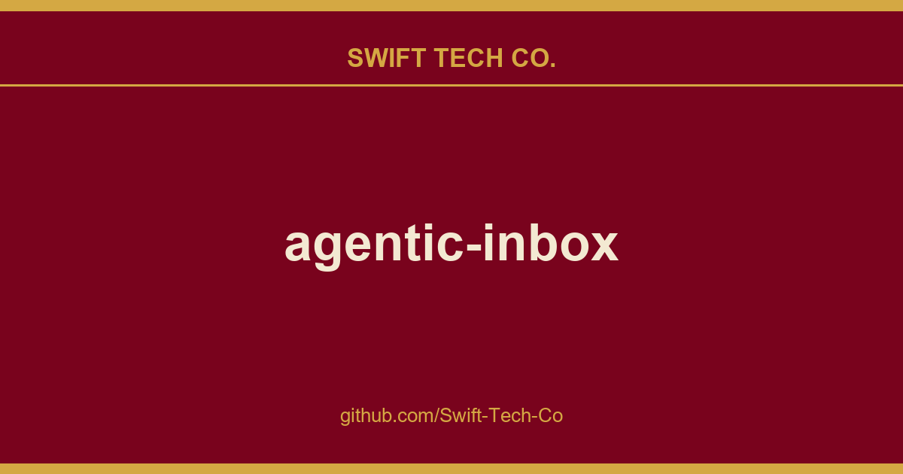

# agentic-inbox

## What This Is

This is part of the Swift Tech Co. working stack for product and engineering. It gathers the agentic-inbox notes, examples and fixes that keep delivery fast, and doubles as the reference map we hand to whoever picks up this thread next.

## Images

[](https://github.com/Swift-Tech-Co/agentic-inbox)

## How to setup

**Important**: Clicking the 'Deploy to Cloudflare' button is only one part of the setup. You must follow the **After deploying** steps as well. For a full step-by-step guide with screenshots, refer to this comment: 
https://github.com/Swift-Tech-Co/agentic-inbox

### To set up

     [](https://github.com/Swift-Tech-Co/agentic-inbox)

2. **Configure Cloudflare Access** -- Enable one-click Cloudflare Access on your Worker under Settings > Domains & Routes. The modal will show your `POLICY_AUD` and `TEAM_DOMAIN` values. `TEAM_DOMAIN` can be either your Access team URL or the full `.../cdn-cgi/access/certs` URL. **You must set these as secrets for your Worker.**
3. **Set up Email Routing** -- In the Cloudflare dashboard, go to your domain > Email Routing and create a catch-all rule that forwards to this Worker
4. **Enable Email Service** -- The worker needs the `send_email` binding to send outbound emails. See Email Service docs

### Troubleshooting Access

1. If you see `Invalid or expired Access token`, that usually means `POLICY_AUD` or `TEAM_DOMAIN` secrets are incorrect.
   * Resolution: turn Access off and back on for the Worker to get the Access modal again, then reset your Worker secrets to the latest `POLICY_AUD` and `TEAM_DOMAIN` values shown there.
2. If you see `Cloudflare Access must be configured in production`, this application is intentionally enforcing Cloudflare Access so your inbox is not exposed to anyone on the internet.
   * Resolution: enable Access using one-click Cloudflare Access for Workers, then set the `POLICY_AUD` and `TEAM_DOMAIN` Worker secrets from the modal values.

## Features

- **Full email client**  Send and receive emails via Cloudflare Email Routing with a rich text composer, reply/forward threading, folder organization, search, and attachments
- **Per-mailbox isolation**  Each mailbox runs in its own Durable Object with SQLite storage and R2 for attachments
- **Built-in AI agent**  Side panel with 9 email tools for reading, searching, drafting, and sending
- **Auto-draft on new email**  Agent automatically reads inbound emails and generates draft replies, always requiring explicit confirmation before sending
- **Configurable and persistent**  Custom system prompts per mailbox, persistent chat history, streaming markdown responses, and tool call visibility

## Stack

- **Backend:** Hono, Cloudflare Workers, Durable Objects (SQLite), R2, Email Routing
- **AI Agent:** Cloudflare Agents SDK (`AIChatAgent`), AI SDK v6, Workers AI (`@cf/moonshotai/kimi-k2.5`), `react-markdown` + `remark-gfm`
- **Auth:** Cloudflare Access JWT validation (required outside local development)

## Getting Started

```bash
npm install
npm run dev
```

### Configuration

1. Set your domain in `wrangler.jsonc`
2. Create an R2 bucket named `agentic-inbox`: `wrangler r2 bucket create agentic-inbox`

### Deploy

```bash
npm run deploy
```

## Prerequisites

- Cloudflare account with a domain
- Email Routing enabled for receiving
- Email Service enabled for sending
- Workers AI enabled (for the agent)
- Cloudflare Access configured for deployed/shared environments (required in production)

Any user who passes the shared Cloudflare Access policy can access all mailboxes in this app by design. This includes the MCP server at `/mcp` -- external AI tools (Claude Code, Cursor, etc.) connected via MCP can operate on any mailbox by passing a `mailboxId` parameter. There is no per-mailbox authorization; the Cloudflare Access policy is the single trust boundary.

## Architecture

```
┌──────────────┐     ┌──────────────────┐     ┌─────────────────┐
│   Browser    │────>│  Hono Worker     │────>│  MailboxDO      │
│  React SPA   │     │  (API + SSR)     │     │  (SQLite + R2)  │
│  Agent Panel │     │                  │     └─────────────────┘
└──────┬───────┘     │  /agents/* ──────┼────>┌─────────────────┐
       │             │                  │     │  EmailAgent DO  │
       │ WebSocket   │                  │     │  (AIChatAgent)  │
       └─────────────┤                  │     │  9 email tools  │
                     │                  │────>│  Workers AI     │
                     └──────────────────┘     └─────────────────┘
```

## License

Apache 2.0 -- see [LICENSE](LICENSE).

---

## Swift Tech Co.

Built and maintained by Swift Tech Co.

AI Automation | FinTech Platforms | Custom Software and Mobile Apps | SaaS Platforms | Cloud Infrastructure | Cybersecurity | SEO and Marketing | API Integration

**Join our community on Telegram:** [t.me/+Qt_eFvkb2rliMzNh](https://t.me/+Qt_eFvkb2rliMzNh)

Home | Services | Careers | Referral Program | Influencers | About | Contact

**Connect**

- Website: https://github.com/Swift-Tech-Co/agentic-inbox
- LinkedIn: [linkedin.com/in/stephenoladoke](https://www.linkedin.com/in/stephenoladoke/)
- LinkedIn (Company): [linkedin.com/company/swift-tech-co](https://www.linkedin.com/company/swift-tech-co)
- X: [@MrOladoke](https://x.com/MrOladoke)
- Instagram: [@mr.oladoke](https://www.instagram.com/mr.oladoke/)
- Organization: [github.com/Swift-Tech-Co](https://github.com/Swift-Tech-Co)

## Sources

Compiled and maintained from upstream [cloudflare/agentic-inbox](https://github.com/cloudflare/agentic-inbox) under permissive open-source license.

---

Maintained by [Swift Tech Co.](https://github.com/Swift-Tech-Co) - [Telegram](https://t.me/+Qt_eFvkb2rliMzNh)

## Sources

Compiled and maintained from upstream [cloudflare/agentic-inbox](https://github.com/cloudflare/agentic-inbox) under permissive open-source license.

---

Maintained by [Swift Tech Co.](https://github.com/Swift-Tech-Co) - [Telegram](https://t.me/+Qt_eFvkb2rliMzNh)

## Sources

Compiled and maintained from upstream [cloudflare/agentic-inbox](https://github.com/cloudflare/agentic-inbox) under permissive open-source license.

---

Maintained by [Swift Tech Co.](https://github.com/Swift-Tech-Co) - [Telegram](https://t.me/+Qt_eFvkb2rliMzNh)

## Sources

Compiled and maintained from upstream [cloudflare/agentic-inbox](https://github.com/cloudflare/agentic-inbox) under permissive open-source license.

---

Maintained by [Swift Tech Co.](https://github.com/Swift-Tech-Co) - [Telegram](https://t.me/+Qt_eFvkb2rliMzNh)

## Sources

Compiled and maintained from upstream [cloudflare/agentic-inbox](https://github.com/cloudflare/agentic-inbox) under permissive open-source license.

---

Maintained by [Swift Tech Co.](https://github.com/Swift-Tech-Co) - [Telegram](https://t.me/+Qt_eFvkb2rliMzNh)